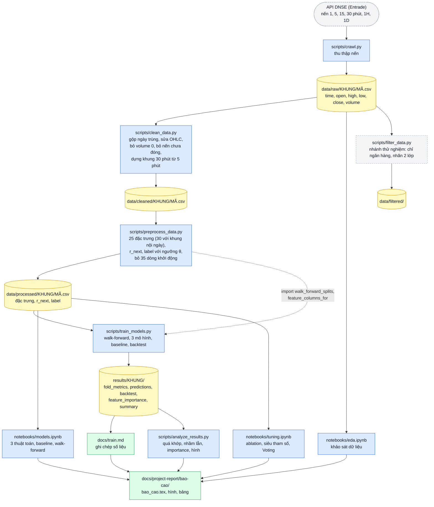
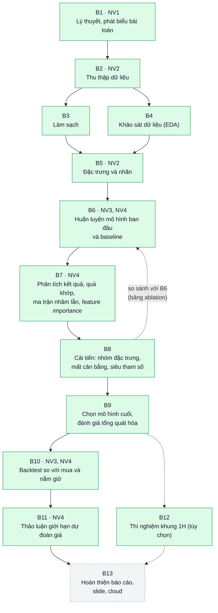
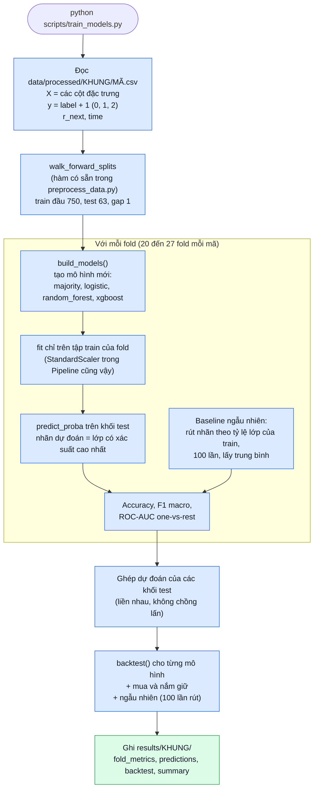
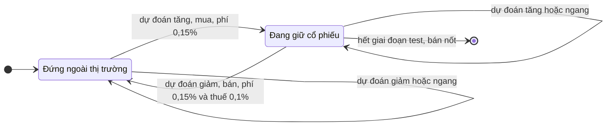

# Đề bài: Dự đoán xu hướng tăng/giảm giá cổ phiếu

# Nhiệm vụ:

1. Nghiên cứu đặc điểm chuỗi giá cổ phiếu và các chỉ báo kỹ thuật (SMA, EMA, RSI, MACD, Bollinger Bands); phát biểu bài toán phân loại xu hướng.
2. Thu thập dữ liệu giá lịch sử của một số mã cổ phiếu (thị trường Việt Nam hoặc quốc tế) và tính toán các chỉ báo kỹ thuật làm đặc trưng.
3. Huấn luyện Logistic Regression, Random Forest, XGBoost với walk-forward validation; so sánh với chiến lược cơ sở (mua và nắm giữ, dự đoán ngẫu nhiên).
4. Đánh giá bằng Accuracy, F1, ROC-AUC và lợi nhuận mô phỏng (backtest đơn giản); thảo luận giới hạn của việc dự đoán giá và nguy cơ quá khớp.

- Gợi ý thuật toán: Logistic Regression, Random Forest, XGBoost, SVM.

# Data:

https://banggia.dnse.com.vn/v2?symbol=TCB
https://banggia.dnse.com.vn/v2?symbol=CTG
https://banggia.dnse.com.vn/v2?symbol=VNM
https://banggia.dnse.com.vn/v2?symbol=ACB

nến: 1d
khoảng crawl: 6 tháng

---

# Kiến trúc và flow hoạt động của dự án

Các sơ đồ dưới đây vẽ bằng Mermaid, hiển thị trực tiếp trên GitHub. Trong VS Code, cần cài tiện ích "Markdown Preview Mermaid Support" để xem ở chế độ xem trước. Chi tiết từng bước và trạng thái nằm ở [flow.md](flow.md); kết quả huấn luyện nằm ở [train.md](train.md).

Chú thích màu: xanh dương là mã nguồn, vàng là dữ liệu, xanh lá là kết quả hoặc bước đã xong, cam là bước làm một phần, xám nét đứt là bước chưa làm.

## 1. Kiến trúc: mã nguồn, dữ liệu và kết quả

Luồng đi từ nguồn dữ liệu đến báo cáo. Mỗi script đọc thư mục dữ liệu ở bước trước và ghi thư mục dữ liệu ở bước sau, không ghi đè dữ liệu thô.



## 2. Quy trình thực hiện theo đề bài

Các bước B1 đến B13 trong [flow.md](flow.md), nối theo thứ tự làm. "NV" là nhiệm vụ của đề bài (mục "Nhiệm vụ" ở trên). Cạnh nét đứt là bước tùy chọn hoặc vòng lặp so sánh.



## 3. Bên trong `train_models.py`

Chạy cho từng mã. Mọi thứ học từ dữ liệu (scaler, mô hình) chỉ được fit trên tập train của fold đang xét, nên khối test không bị rò rỉ.



## 4. Chia dữ liệu walk-forward (khung 1D)

Cửa sổ train mở rộng dần, mỗi khối test dài 63 phiên và liền ngay khối trước. Phiên cuối của train bị bỏ vì nhãn của nó dùng giá đóng cửa của phiên test đầu tiên.

```text
Fold 1   [=========== train 750 ===========] gap [-- test 63 --]
Fold 2   [============== train 813 ==============] gap [-- test 63 --]
Fold 3   [================= train 876 =================] gap [-- test 63 --]
  ...
Fold N   [========================= train mở rộng =========================] gap [-- test 63 --]

         |---------------------------- thời gian ---------------------------->
```

Số fold: TCB 20, CTG 27, VNM 27, ACB 27. Siêu tham số (ở bước tinh chỉnh sắp tới) chỉ được chọn trên 20% cuối của tập train, không dùng khối test.

## 5. Quy tắc giao dịch của backtest

Quyết định cuối phiên `t` ăn lợi suất của phiên `t+1`. Chiến lược chỉ mua (long-only) vì thị trường Việt Nam không cho bán khống.


